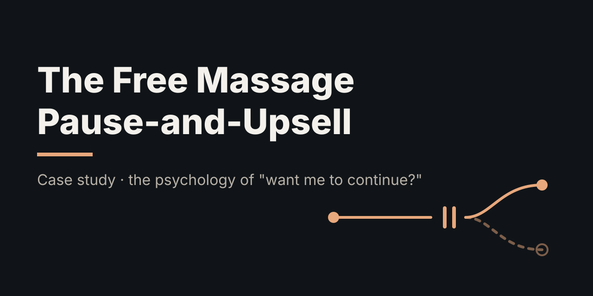
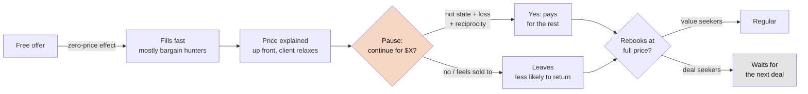

# The Free Massage Pause-and-Upsell: The Psychology Behind It

> **TL;DR:** The reel suggests giving away free 30-minute massages, telling the client up front that you'll pause halfway and offer the rest at a stated price. Each piece is grounded in real psychology: a free gift, a relaxed client, and a pleasant experience cut off mid-way. Stating the price in advance is smart, because it removes most of the "ambush" feeling. The real weak spot isn't the pause. It's who "free" attracts: bargain hunters who rarely come back at full price. In the model, filtering *who* gets the free session matters more than anything said on the table.

**Spark:** [Instagram reel by @elliotmanson_](https://www.instagram.com/reel/DeajmNQzkIk/) · **Angle:** case study (psychology deep dive) · **Date:** 2026-10-13

## The claim vs. reality

**The reel's pitch, in short:** The "one thing" to grow a massage or facial business is to give away free 30-minute sessions with an option to upgrade halfway through. Before you start, explain the structure: at the halfway point you'll pause, ask if they want to continue, and here is the price. Setting that expectation lets the client relax, because there's no surprise bill. A free session is easy to market, lets people find out whether they like your work, and you keep doing it until repeat clients fill your calendar.

**What the comments said:** The most-liked replies came from people in the industry and pushed back hard. Free offers draw price-sensitive clients who want discounts and don't stick. One therapist said their 30-minute service had the fewest bookings and the worst retention. Short sessions with a possible extension make scheduling hard. Another commenter called it "a great way to burn out as a practitioner."

**What the research says:**

| Piece of the tactic | Psychology it uses | Evidence | Verdict |
|---|---|---|---|
| "Free" first session | Zero-price effect | Strong: a price of zero changes choices far more than a one-cent drop [1] | ✅ Fills the calendar |
| Gift → paid rebook | Reciprocity | Robust classic effect [2], but obligation fades once the debt is repaid | ✅ Real, short-lived |
| Pause while they're relaxed | Hot-cold empathy gap | Visceral states push the value of "more now" up [3] | ✅ Real; telling them in advance makes it fairer |
| Cutting off a pleasant experience | Interruption, endowment, Zeigarnik | Breaks can make the rest of a massage *more* enjoyable [4]; giving up something you already have feels like a loss [5] | ✅ Clever |
| Who shows up for free | Adverse selection | Free-trial customers had 59% lower lifetime value [6]; ~20% of daily-deal users returned at full price [7] | ❌ The biggest hidden cost |
| Price disclosed before they lie down | Persuasion knowledge, reactance | A tactic that is spotted gets discounted [8]; disclosing it in advance avoids the surprise [9] | ✅ The reel's best detail |
| Reviews and word of mouth | Selection again | Daily-deal merchants saw lower Yelp ratings afterwards [10] | ⚠️ Mixed |

The reel is right that the mechanism works in the moment, and its insistence on stating the price up front is the right call. What it skips is selection: who a free offer brings in, and how many of them ever pay full price. The claim that you'll fill up with repeat clients before free sessions overwhelm you is the part the evidence (and the industry commenters) disputes.

## How it works



Two loops run at once. The **in-session loop** (relaxation → interruption → offer) is built to maximise the "yes" in the moment. The **selection loop** (who a free offer attracts → whether they ever pay full price) decides whether the business grows. The reel only talks about the first.

## Deep dive

### 1. Why "free" beats "cheap": the zero-price effect

Shampanier, Mazar and Ariely offered people a Lindt truffle or a Hershey's Kiss. When both prices dropped by one cent, so the Kiss went from 1¢ to free, demand swung sharply toward the free item, even though the price *difference* between the two hadn't changed [1]. Their best explanation was emotional: free has no downside, so it *feels* better, not just cheaper. (One critique argues that standard economics can explain the result [1].)

**For the reel:** a free massage will fill slots much faster than a $49 one. That is the tactic's real strength, and also its trap, as section 5 shows.

### 2. Reciprocity: the gift that asks for something back

In Regan's 1971 study, a confederate either bought participants a Coke or didn't, then asked them to buy raffle tickets. People who got the drink bought more tickets, and the favour mattered more than whether they liked the person [2]. A free massage is a much bigger gift than a Coke, and it comes with touch and personal attention.

**The catch:** reciprocity creates a *debt*, and saying yes to the paid extension pays it off. After that, the obligation is gone. The client who extends feels square. The client who declines may feel awkward, which is not the feeling you want them to have when deciding whether to rebook.

### 3. The hot state: asking at peak relaxation

Loewenstein's hot-cold empathy gap: in a strong physical state (hunger, craving, pain, pleasure), people overvalue whatever satisfies it right now and struggle to predict how they'll feel once calm [3]. Fifteen minutes into a massage, the client is in exactly that kind of state. Asking "continue?" then gets a different answer than asking at the front desk.

This is the most effective part of the script. The reel softens the ethics in one important way: the client hears the structure and the price *before* lying down, so the halfway question is a check-in they agreed to, not an ambush. The ABMP Code of Ethics centres the client's right to decide what happens in the session [9], and agreeing up front respects that. The decision still happens in the hot state, though, and that's the point of the timing. The fairest version also makes "no thanks, finish my free half" an easy, normal answer.

### 4. The pause itself: interruption, loss and unfinished business

Three effects stack here:

- **Interruption makes pleasure stronger.** Nelson and Meyvis found that breaks during pleasant experiences, including time in a massage chair, made what followed more enjoyable, because they reset hedonic adaptation [4]. Their follow-up found the same for TV with ad breaks. So the pause doesn't spoil the massage. It makes the second half feel better, *if* the client pays for it.
- **Endowment and loss aversion.** Kahneman, Knetsch and Thaler found that owners demanded roughly twice as much to give up a mug as buyers would pay for it [5]. Halfway in, the full session already feels like *yours*. Stopping now feels like losing something, not missing out on something.
- **The Zeigarnik pull.** An experience cut off half-way stays on the mind (a popular idea; the evidence for the classic memory effect is weaker than its fame).

There is also a **peak-end** cost. People judge an experience heavily by its best moment and how it ended [11]. If the client declines, the last moment of the free session is a sales pitch followed by getting dressed. That ending is what they'll remember.

### 5. Adverse selection: who actually shows up for free

This is where the industry commenters were right and the reel was silent.

- **Datta, Foubert and van Heerde** (16,512 customers of a European digital-TV provider): customers acquired through free trials had **59% lower** lifetime value than regular customers. Reporting on the paper said they stayed about **one-third** as long [6].
- **Dholakia's Groupon surveys** (Rice University): in the 2011 study of 324 businesses, **80%** of deal users were new customers, but only **19.9%** came back to pay full price, and **26.6%** of businesses lost money on the promotion [7]. In the 2010 study, businesses that sold more than 1,000 deals were less likely to profit, because deal users crowded out regulars who paid full price. One point in the reel's favour: in the 2011 survey, more than 70% of health, services and special-event businesses (the category massage falls in) made money on their deal, far more than restaurants (43.6%). Low marginal cost per session helps. The problem is the low return rate, not that the first visit loses money.
- **Byers, Mitzenmacher and Zervas**: after merchants ran Groupon deals, their Yelp ratings dropped on average. The likely explanation is a poorer fit between merchant and customer, not worse service [10]. So "free sessions = great reviews" is not a safe assumption.

A free offer doesn't just pull in more people. It pulls in *different* people. Price is a filter, and "free" removes it.

### 6. Persuasion knowledge: why disclosing in advance matters

Friestad and Wright's Persuasion Knowledge Model describes a "change of meaning": once a target sees an action as a persuasion attempt, they reinterpret it and discount the person behind it [8]. A free massage that turns into a surprise sales pitch is exactly that kind of moment, like a timeshare or gym-tour upsell.

The reel's up-front disclosure takes most of the sting out. There's no hidden move to uncover, so the change of meaning happens at booking, when the client can walk away cheaply, not on the table. Some reactance will remain (a client may still feel pressured to say yes after being given something), which is why the model keeps a smaller penalty for people who decline.

The foot-in-the-door literature is a useful check here: starting small to get a bigger yes later does replicate, but Beaman et al.'s meta-analysis called it weak and found that nearly half the studies showed no effect or the reverse [12].

### 7. What the model says

`code/funnel_sim.py` turns each effect above into a dial (assumed values, not measured ones) and runs four strategies on a 40-client cohort over 12 months:

```
strategy                           12-mo rev  profit* hands-on h  free h  $/hour regulars@m6 extended
-----------------------------------------------------------------------------------------------------
A. Free 30 + pause pitch (reel)        3,913    3,397         53      20      74         1.3     16.2
B. Free 30, offer after                3,862    3,284         52      20      74         1.6      0.0
C. $49 intro 60 min                    7,336    6,658         85       0      87         2.8      0.0
D. Full price + guarantee             11,648   10,871         97       0     120         4.0      0.0
* profit = revenue minus consumables; therapist time not costed.

Intro clients needed to end month 6 with 4.0 regulars (D's result):
  A. Free 30 + pause pitch (reel)      127
  B. Free 30, offer after               98
  C. $49 intro 60 min                   57
  D. Full price + guarantee             40
```

How to read it:

- **A vs. B is nearly a tie in revenue, but B keeps more regulars.** The default run assumes a fairly harsh backlash (people who decline keep only 60% of their rebooking intent). The break-even scan shows the pitch wins whenever decliners keep more than about 55%. Because the reel discloses the price up front, the backlash is probably milder than the default, which tilts this toward the reel. Nobody has measured this number for massage. It's the thing to test.
- **The biggest lever is who shows up.** Switching off adverse selection alone raises strategy A's revenue by about 70% (3,913 → 6,605). Reciprocity and the hot state help A, but by about 500–600 each. Selection outweighs all the in-session psychology.
- **Same cohort size flatters the paid options.** Full-price strangers are much harder to find than free ones. The fair question is the second table: free needs roughly **2.5–3×** as many intro clients to build the same base of regulars. If free slots really are that much easier to fill and your time is cheap right now (an empty calendar), free can still make sense. If your hours are already the bottleneck, it doesn't.
- **"Do it until you're at capacity" is the risky part.** The reel assumes repeat clients will fill your calendar before free sessions do. At these retention rates, about 100–130 free sessions produce about 4 regulars by month 6. The free hours fill up long before the regulars do, which is the burnout the commenters warned about.

## Apply it

```bash
python3 code/funnel_sim.py
python3 code/funnel_sim.py --preset dog-daycare
```

Each preset lives in the `PRESETS` dict at the top of the file. Copy one and change the price, visit frequency, client types and psychology levers to match your own business. Full output and parameter notes are in [`code/README.md`](code/README.md).

If you want the benefits of the free session without the downsides:

1. **Keep the reel's up-front disclosure.** It's the strongest part of the script. Say the structure and the price at booking and again before they lie down, and make declining sound normal.
2. **Put a small price on it instead of zero.** Even $20–49 screens out much of the pure deal-seeking (strategy C) while keeping a low barrier.
3. **Filter who gets the free slot.** Give it to people with a real reason to become regulars: referrals from existing clients, local employers, people with a specific problem you treat. Don't give it to anyone who clicks.
4. **Cap the free slots.** Set a weekly limit (for example, 4 free slots) so free hours never crowd out paying clients. Dholakia found deals that oversold were the ones that lost money [7].
5. **Measure the one unknown number.** Track whether people who decline an extension rebook less than people who were never asked. That single rate tells you whether the pause pitch helps or hurts.

### The dog-business version

Dog PPL, the members' club for dogs that opened in LA, shows the *filter* half of this psychology without using "free." Membership is about $120 per dog per month, and every dog must pass an in-person behavior assessment first [14][15]. That one step screens out bad fits, makes membership feel exclusive, and gets a small commitment up front, which is exactly the fix for the adverse-selection problem above.

The same effects carry over to dogs, with one difference: owners are emotionally invested, and a dog's happiness is easy to see. A photo or 10-second clip of the dog playing is the "hot state," and it reaches the owner wherever they are.

| Effect | Massage version | Dog version |
|---|---|---|
| Hot state | Client relaxed on the table | Owner sees a midday photo of their dog having a great time |
| Pause and continue | "Continue for $X?" at halfway | Free half-day trial, price explained at drop-off. Midday text: "Milo's made two friends. Make it a full day for $27?" |
| Endowment and loss | The session already feels like yours | The dog's friendships feel like yours: "Milo's playgroup meets Tuesdays and Thursdays." |
| Reciprocity | Free massage | Free nail trim, photo shoot or training mini-lesson at a pop-up |
| Adverse selection | Free attracts bargain hunters | Free attracts people looking for free off-leash space. Charge a small assessment fee and credit it toward the first month. |
| Peak-end | Don't end on a sales pitch | End on the dog: a tired, happy pup and a "report card" text with photos at pickup |

**What the dog-daycare preset shows** (`--preset dog-daycare`, all values illustrative):

```
strategy                           12-mo rev  profit*   dog-days    free  $/unit regulars@m6 extended
-----------------------------------------------------------------------------------------------------
A. Free half-day + photo upsell       15,058   13,226        294      20      51         2.9     16.8
B. Free half-day, offer pickup        15,902   13,927        309      20      51         3.1      0.0
C. $25 assessment day (credit)        23,236   20,571        444       0      52         5.0      0.0
D. Full price first day               28,051   24,991        510       0      55         6.1      0.0
```

- **For recurring businesses, the mid-visit upsell barely pays.** Finishing the day earns about $27. A regular is worth about 6 days a month. Even with a mild backlash (decliners keep 85% of their intent to return), the upsell loses to making the offer at pickup. It only breaks even if declining causes no backlash at all. The more of your revenue comes from repeat visits, the more you should protect rebooking instead of maximising the first visit.
- **The paid assessment ($25, credited) is the sweet spot.** It builds about 60% more regulars than a free trial from the same number of intro dogs. It's the Dog PPL model in miniature.
- **Selection still dominates.** Removing the deal-seeker effect raises strategy A's revenue by 60% (15,058 → 24,204).

## Assumptions

Every number in the model is a dial, not a measurement. Here's what each one is anchored to.

| Parameter | Massage | Dog daycare | Anchored to |
|---|---|---|---|
| Full price | $120 / hour | $55 / day | Typical US urban prices; illustrative |
| Regular visit frequency | 1 / month | 6 / month | Illustrative guess |
| Deal-seeker share (free / discount / full) | 65% / 45% / 25% | 60% / 40% / 25% | Direction from [6][7]; levels are guesses |
| First paid rebook (deal / value client) | 10% / 40% | 12% / 45% | ~20% full-price return for daily-deal users [7] |
| Monthly retention (deal / value client) | 55% / 80% | 65% / 85% | Free-trial customers stay about a third as long [6]; levels are guesses |
| Reciprocity boost (free) | ×1.25 | ×1.20 | Direction from [2]; size is a guess |
| Hot-state boost to "continue?" | ×1.50 | ×1.40 | Direction from [3][4][5]; size is a guess |
| Rebook kept by people who decline the upsell | 60% | 85% | Unmeasured. The key number to test [8] |
| Retention after a free (zero-price) start | ×0.92 | ×0.94 | Direction from [1]; size is a guess |

## Takeaways

- The reel's tactic stacks real effects: zero price, reciprocity, a hot state, endowment and interruption. That's why it *feels* like it should work.
- What "free" really does is change **who** walks in, and that matters more than any in-session persuasion.
- The halfway "continue?" is the most persuasive moment. The reel's up-front disclosure is what keeps it from costing you trust.
- A small price, or a free session offered to filtered people with the offer made afterwards, keeps most of the upside.
- The deciding number (how much declining an extension lowers rebooking) is unmeasured. Test it before you scale.
- The more a business runs on repeat visits (daycare, memberships), the less a first-visit upsell is worth compared with protecting the rebook.

## Open questions

- Do clients who decline a mid-session extension actually rebook less? No massage-specific data exists. It's the key input to the model.
- Does the Nelson & Meyvis interruption benefit hold when the break carries a price tag, or does the sales framing cancel it out?
- How much does practitioner burnout cost (lost hours, injury, shorter careers) once free sessions fill a calendar? The model doesn't cost therapist time.
- Would a "pay what you think it was worth" first session get the reciprocity without the zero-price selection problem?

## Sources

1. [Shampanier, Mazar & Ariely (2007), "Zero as a Special Price: The True Value of Free Products," *Marketing Science* 26(6)](https://doi.org/10.1287/mksc.1060.0254): free changes choices far more than a one-cent price cut
2. [Regan (1971), "Effects of a Favor and Liking on Compliance," *J. Experimental Social Psychology* 7(6)](https://doi.org/10.1016/0022-1031%2871%2990025-4): the Coke-and-raffle-tickets reciprocity study
3. [Loewenstein (2005), "Hot-cold empathy gaps and medical decision making," *Health Psychology*](https://doi.org/10.1037/0278-6133.24.4.S49): visceral states distort choices in the moment
4. [Nelson & Meyvis (2008), "Interrupted Consumption: Disrupting Adaptation to Hedonic Experiences," *JMR* 45](https://doi.org/10.1509/jmkr.45.6.654): breaks make pleasant experiences, including massage chairs, more enjoyable (follow-up on TV ads: [Nelson, Meyvis & Galak 2009](https://doi.org/10.1086/597220))
5. [Kahneman, Knetsch & Thaler (1990), "Experimental Tests of the Endowment Effect and the Coase Theorem," *JPE* 98(6)](https://doi.org/10.1086/261737): owners value things about twice as much as buyers
6. [Datta, Foubert & van Heerde (2015), "The Challenge of Retaining Customers Acquired with Free Trials," *JMR* 52(2)](https://doi.org/10.1509/jmr.12.0160): 59% lower lifetime value for free-trial customers
7. [Dholakia (2011), "How Businesses Fare With Daily Deals," Rice University](https://digitalwellbeing.org/downloads/Rice_Report_Groupon.pdf) ([Rice press summary](https://www.sciencedaily.com/releases/2011/06/110614154548.htm)): 19.9% of deal users returned at full price; 26.6% of businesses lost money; health and services businesses did best
8. [Friestad & Wright (1994), "The Persuasion Knowledge Model," *J. Consumer Research* 21(1)](https://doi.org/10.1086/209380): people discount a seller once they spot the tactic
9. [ABMP Code of Ethics for Massage Therapists](https://seven.abmp.com/node/371): client consent, comfort and self-determination in the session
10. [Byers, Mitzenmacher & Zervas (2012), "The Groupon Effect on Yelp Ratings: A Root Cause Analysis"](https://www.arxiv.org/pdf/1202.2369): ratings drop after daily deals, mainly due to customer fit
11. [Kahneman, Fredrickson, Schreiber & Redelmeier (1993), "When More Pain Is Preferred to Less," *Psychological Science* 4](https://doi.org/10.1111/j.1467-9280.1993.tb00589.x): the peak-end rule
12. [Beaman et al. (1983), "Fifteen years of foot-in-the-door research: A meta-analysis," *PSPB* 9](https://doi.org/10.1177/0146167283092002): the effect replicates but is weak
13. [Massage Envy introductory pricing (franchise releases, 2011–12)](https://www.franchising.com/amp/news/20120111_massage_envy_spa_germantown_allows_first_time_gues.html): the industry's established version is a *discounted* intro ($49) leading to a membership ($59/mo), not a free one
14. [The Hollywood Reporter on Dog PPL's members-only dog club](https://www.hollywoodreporter.com/lifestyle/lifestyle-news/members-only-dog-park-hollywood-pets-1236405496/): LA memberships from $120/month
15. [InsideHook on Dog PPL's expansion to New York](https://www.insidehook.com/leisure/dog-ppl-opening-brooklyn-location-member-club/amp): $120 per dog per month in LA, $25 for each extra dog, behavior assessment required

---
*Assumptions:* the model's parameters are illustrative and not fitted to any real practice. The reel says "upgrade halfway through" without saying to what, so the model assumes a 30-minute free session that can be extended to a paid 60 minutes. The reel was summarised in my own words from its audio and captions. No transcript is reproduced here.
