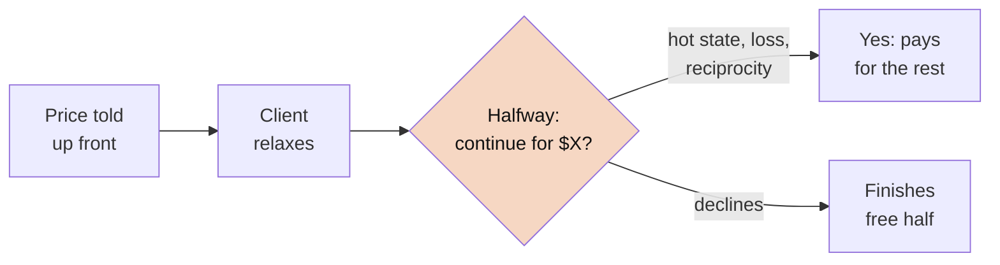
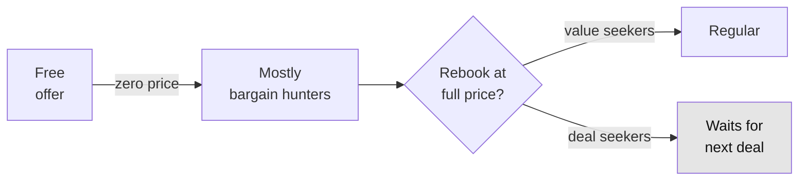

# The Free Massage Pause-and-Upsell: The Psychology Behind It

> **TL;DR:** The reel's idea: give away free 30-minute massages, tell the client up front you'll pause halfway, and offer the rest at a set price. Every piece of that has real psychology behind it: a free gift, a relaxed client, a good experience cut off in the middle. Saying the price in advance is smart, since it takes the "ambush" feeling out of it. The weak spot isn't the pause. It's who "free" pulls in: bargain hunters who rarely come back at full price. In the model, being picky about *who* gets the free session matters more than anything you say on the table.

**Spark:** [Instagram reel by @elliotmanson_](https://www.instagram.com/reel/DeajmNQzkIk/) · **Angle:** case study (psychology deep dive) · **Date:** 2026-10-13

## The claim vs. reality

**What the reel says:** if you want to grow a massage or facial business, the one thing to do is give away free 30-minute sessions with an option to upgrade halfway through. Before you start, you explain how it works: at the halfway mark you'll pause, ask if they want to keep going, and here's the price. Because they know what's coming, they can relax. No surprise bill. A free session is easy to market, people get to find out if they like your work, and you keep going until repeat clients fill your calendar.

**What the comments said:** the most-liked replies came from people in the industry, and they pushed back hard. Free offers pull in price-sensitive clients who want discounts and don't stick around. One therapist said their 30-minute service had the fewest bookings and the worst retention of anything they offered. Short sessions that might turn into long ones also make scheduling a mess. Another commenter called it "a great way to burn out as a practitioner."

**What the research says:**

| Piece of the tactic | Psychology it uses | Evidence | Verdict |
|---|---|---|---|
| "Free" first session | Zero-price effect | Strong: a price of zero changes choices far more than a one-cent drop [1] | ✅ Fills the calendar |
| Gift → paid rebook | Reciprocity | Robust classic effect [2], but obligation fades once the debt is repaid | ✅ Real, short-lived |
| Pause while they're relaxed | Hot-cold empathy gap | Visceral states push the value of "more now" up [3] | ✅ Real; telling them in advance makes it fairer |
| Cutting off a pleasant experience | Interruption, endowment, Zeigarnik | Breaks can make the rest of a massage *more* enjoyable [4]; giving up something you already have feels like a loss [5] | ✅ Clever |
| Who shows up for free | Adverse selection | Free-trial customers had 59% lower lifetime value [6]; ~20% of daily-deal users returned at full price [7] | ❌ The biggest hidden cost |
| Price disclosed before they lie down | Persuasion knowledge, reactance | A tactic that is spotted gets discounted [8]; disclosing it in advance avoids the surprise [9] | ✅ The reel's best detail |
| Reviews and word of mouth | Selection again | Daily-deal merchants saw lower Yelp ratings afterwards [10] | ⚠️ Mixed |

He's right that the mechanism works in the moment, and saying the price up front is the right call. What he skips is selection: who a free offer actually brings in, and how many of them ever pay full price. The part the evidence (and the commenters) push back on is the promise that repeat clients will fill you up before the free sessions wear you out.

## How it works

**In-session loop**: built to get a "yes" in the moment.



**Selection loop**: decides whether the business grows.



Both loops run at the same time. The reel only talks about the first one. The second one decides whether you actually grow.

## Deep dive

### 1. Why free beats cheap

Shampanier, Mazar and Ariely offered people a Lindt truffle or a Hershey's Kiss. When they knocked a cent off both, so the Kiss went from 1¢ to free, people swung hard toward the free one, even though the price *gap* between the two hadn't moved [1]. Their best explanation is emotional. Free has no downside, so it *feels* better, not just cheaper. (One critique argues standard economics can explain the result [1].)

**What that means here:** a free massage will fill your slots way faster than a $49 one. That's the tactic's real strength. It's also the trap, as you'll see in section 5.

### 2. Reciprocity: a gift that wants something back

In Regan's 1971 study, a confederate either bought people a Coke or didn't, then asked them to buy raffle tickets. People who got the Coke bought more tickets, and the favour mattered more than whether they even liked the guy [2]. A free massage is a much bigger gift than a Coke, and it comes with touch and one-on-one attention.

The catch is that reciprocity creates a *debt*, and saying yes to the paid extension pays it off. After that, the obligation's gone. The client who extends feels square. The client who says no might feel a bit awkward, and that's not the feeling you want them walking out with when they decide whether to rebook.

### 3. Asking at peak relaxation

This is Loewenstein's hot-cold empathy gap. When you're in a strong physical state (hungry, craving something, in pain, deep in pleasure), you overvalue whatever feeds that state right now, and you're bad at predicting how you'll feel once you calm down [3]. Fifteen minutes into a massage, the client is right in that state. Ask "want to keep going?" then and you'll get a different answer than you would at the front desk.

It's the most effective part of the script. The reel does soften the ethics in one big way: the client hears the setup and the price *before* lying down, so the halfway question is a check-in they already agreed to, not an ambush. Agreeing up front respects what the ABMP Code of Ethics puts front and centre: the client's right to decide what happens in the session [9]. But they still make the call while they're blissed out. That's why the timing works. The fairest version also makes "no thanks, I'll finish my free half" feel like a normal, easy answer.

### 4. The pause: interruption, loss and unfinished business

Three effects stack up at the pause:

- **Breaks make pleasure stronger.** Nelson and Meyvis found that interrupting a pleasant experience, including time in a massage chair, made the rest of it more enjoyable, because the break resets how fast you get used to it [4]. Their follow-up found the same thing for TV with ad breaks. So the pause doesn't ruin the massage. It makes the second half feel better, *if* the client pays for it.
- **Endowment and loss aversion.** Kahneman, Knetsch and Thaler found people wanted roughly twice as much to give up a mug they owned as buyers would pay for it [5]. Halfway in, the full session already feels like *yours*. Stopping now feels like losing something, not passing on something.
- **The Zeigarnik pull.** Something cut off halfway tends to stay on your mind. (It's a popular idea, but the evidence for the classic memory effect is weaker than its reputation.)

There's also a **peak-end** cost. People judge an experience mostly by its best moment and how it ended [11]. If the client says no, the last thing that happens in the free session is a sales pitch, then getting dressed. That's the ending they'll remember.

### 5. Who actually shows up for free

This is where the commenters were right and the reel didn't say a word.

- **Datta, Foubert and van Heerde** looked at 16,512 customers of a European digital-TV provider. People who came in through free trials had **59% lower** lifetime value than regular customers, and press coverage of the paper said they stayed about **one-third** as long [6].
- **Dholakia's Groupon surveys** (Rice University): in the 2011 study of 324 businesses, **80%** of deal users were new customers, but only **19.9%** came back to pay full price, and **26.6%** of businesses lost money on the promotion [7]. In the 2010 study, businesses that sold more than 1,000 deals were less likely to make money, because deal users crowded out the regulars paying full price. One point for the reel: in the 2011 survey, more than 70% of health, services and special-event businesses (massage falls in there) made money on their deal, way more than restaurants (43.6%). A session doesn't cost much extra to deliver, which helps. The problem is how few people come back, not that the first visit loses money.
- **Byers, Mitzenmacher and Zervas** found that merchants' Yelp ratings dropped on average after they ran Groupon deals. The likely reason is a worse fit between business and customer, not worse service [10]. So don't assume free sessions mean great reviews.

A free offer doesn't just bring in more people. It brings in *different* people. Price works as a filter, and free switches it off.

### 6. Why saying the price up front matters

Friestad and Wright's Persuasion Knowledge Model describes a "change of meaning." Once someone realises they're being sold to, they reread everything that came before and trust the seller less [8]. A free massage that suddenly turns into a sales pitch is exactly that moment, like a timeshare tour or a gym visit that ends in a hard sell.

The reel's up-front disclosure takes most of the sting out. There's no hidden move to discover, so that change of meaning happens at booking, when walking away costs nothing, not halfway through on the table. You'll still get some pushback (people can feel pressured to say yes after getting something free), which is why the model keeps a smaller penalty for people who decline.

The foot-in-the-door research is a good reality check here. Starting with a small ask to land a bigger one does replicate, but Beaman et al.'s meta-analysis called the effect weak, and nearly half the studies found nothing or the opposite [12].

### 7. What the model says

`code/funnel_sim.py` turns each of those effects into a dial (assumed values, not measured ones) and runs four strategies on 40 intro clients over 12 months:

```
strategy                           12-mo rev  profit* hands-on h  free h  $/hour regulars@m6 extended
-----------------------------------------------------------------------------------------------------
A. Free 30 + pause pitch (reel)        3,913    3,397         53      20      74         1.3     16.2
B. Free 30, offer after                3,862    3,284         52      20      74         1.6      0.0
C. $49 intro 60 min                    7,336    6,658         85       0      87         2.8      0.0
D. Full price + guarantee             11,648   10,871         97       0     120         4.0      0.0
* profit = revenue minus consumables; therapist time not costed.

Intro clients needed to end month 6 with 4.0 regulars (D's result):
  A. Free 30 + pause pitch (reel)      127
  B. Free 30, offer after               98
  C. $49 intro 60 min                   57
  D. Full price + guarantee             40
```

How to read it:

- **A and B are basically tied on revenue, but B keeps more regulars.** The default run assumes a pretty harsh backlash: people who decline keep only 60% of their intent to rebook. The break-even scan shows the pitch wins whenever decliners keep more than about 55%. Since the reel tells people the price up front, the real backlash is probably milder than that, which tilts things toward the reel. Nobody's measured this for massage. It's the number to test.
- **The biggest lever is who walks in.** Switching off adverse selection on its own raises strategy A's revenue by about 70% (3,913 → 6,605). Reciprocity and the hot state help A too, but only by about 500–600 each. Who shows up beats all the in-session psychology combined.
- **Using the same number of clients flatters the paid options.** Strangers willing to pay full price are much harder to find than people who'll take something free. The fairer comparison is the second table: free needs roughly **2.5–3×** as many intro clients to build the same group of regulars. If free slots really are that much easier to fill and your calendar's empty anyway, free can still make sense. If your hours are already the bottleneck, it doesn't.
- **"Keep going until you're at capacity" is the risky part.** The reel assumes repeat clients fill your calendar before the free sessions do. At these retention rates, about 100–130 free sessions get you about 4 regulars by month 6. Your hours fill up with free sessions long before the regulars show up, which is exactly the burnout the commenters warned about.

## Apply it

```bash
python3 code/funnel_sim.py
python3 code/funnel_sim.py --preset dog-daycare
```

Each preset lives in the `PRESETS` dict at the top of the file. Copy one and change the price, how often regulars come, the client types and the psychology dials to match your business. Full output and parameter notes are in [`code/README.md`](code/README.md).

If you want what's good about the free session without the downsides:

1. **Keep the up-front disclosure.** It's the best part of the script. Say the setup and the price when they book and again before they lie down, and make "no thanks" sound normal.
2. **Charge a little instead of nothing.** Even $20–49 screens out a lot of pure deal-seeking (strategy C) and still keeps the barrier low.
3. **Be picky about who gets the free slot.** Give it to people with a real reason to become regulars: referrals from current clients, local employers, people with a specific problem you treat. Not just anyone who clicks.
4. **Cap the free slots.** Set a weekly limit (say, 4 free slots) so free hours never push out paying clients. Dholakia found the deals that oversold were the ones that lost money [7].
5. **Track the one number nobody knows.** Check whether people who turn down an extension rebook less than people who were never asked. That one rate tells you if the pause pitch helps or hurts.

### The dog-business version

Dog PPL, the members' club for dogs that opened in LA, uses the *filter* half of this psychology without giving anything away. Membership is about $120 per dog per month, and every dog has to pass an in-person behavior assessment first [14][15]. That one step weeds out bad fits, makes membership feel exclusive, and gets a small commitment up front. It's exactly the fix for the adverse-selection problem above.

The same effects carry over to dogs, with one twist: owners are emotionally invested, and a happy dog is easy to see. A photo or 10-second clip of the dog playing is the "hot state," and it reaches the owner wherever they are.

| Effect | Massage version | Dog version |
|---|---|---|
| Hot state | Client relaxed on the table | Owner sees a midday photo of their dog having a great time |
| Pause and continue | "Continue for $X?" at halfway | Free half-day trial, price explained at drop-off. Midday text: "Milo's made two friends. Make it a full day for $27?" |
| Endowment and loss | The session already feels like yours | The dog's friendships feel like yours: "Milo's playgroup meets Tuesdays and Thursdays." |
| Reciprocity | Free massage | Free nail trim, photo shoot or training mini-lesson at a pop-up |
| Adverse selection | Free attracts bargain hunters | Free attracts people looking for free off-leash space. Charge a small assessment fee and credit it toward the first month. |
| Peak-end | Don't end on a sales pitch | End on the dog: a tired, happy pup and a "report card" text with photos at pickup |

**What the dog-daycare preset shows** (`--preset dog-daycare`, all values illustrative):

```
strategy                           12-mo rev  profit*   dog-days    free  $/unit regulars@m6 extended
-----------------------------------------------------------------------------------------------------
A. Free half-day + photo upsell       15,058   13,226        294      20      51         2.9     16.8
B. Free half-day, offer pickup        15,902   13,927        309      20      51         3.1      0.0
C. $25 assessment day (credit)        23,236   20,571        444       0      52         5.0      0.0
D. Full price first day               28,051   24,991        510       0      55         6.1      0.0
```

- **When the money's in repeat visits, the mid-visit upsell barely pays.** Finishing the day earns you about $27. A regular is worth about 6 days a month. Even with a mild backlash (people who decline keep 85% of their intent to come back), the upsell loses to just making the offer at pickup. It only breaks even if saying no causes zero backlash. The more your revenue comes from repeat visits, the more you should protect the rebook instead of squeezing the first visit.
- **The paid $25 assessment (credited back) is the sweet spot.** It builds about 60% more regulars than a free trial from the same number of intro dogs. Basically Dog PPL's model in miniature.
- **Who shows up still matters most.** Removing the deal-seeker effect raises strategy A's revenue by 60% (15,058 → 24,204).

## Assumptions

Every number in the model is a dial, not a measurement. Here's what each one's based on.

| Parameter | Massage | Dog daycare | Anchored to |
|---|---|---|---|
| Full price | $120 / hour | $55 / day | Typical US urban prices; illustrative |
| Regular visit frequency | 1 / month | 6 / month | Illustrative guess |
| Deal-seeker share (free / discount / full) | 65% / 45% / 25% | 60% / 40% / 25% | Direction from [6][7]; levels are guesses |
| First paid rebook (deal / value client) | 10% / 40% | 12% / 45% | ~20% full-price return for daily-deal users [7] |
| Monthly retention (deal / value client) | 55% / 80% | 65% / 85% | Free-trial customers stay about a third as long [6]; levels are guesses |
| Reciprocity boost (free) | ×1.25 | ×1.20 | Direction from [2]; size is a guess |
| Hot-state boost to "continue?" | ×1.50 | ×1.40 | Direction from [3][4][5]; size is a guess |
| Rebook kept by people who decline the upsell | 60% | 85% | Unmeasured. The key number to test [8] |
| Retention after a free (zero-price) start | ×0.92 | ×0.94 | Direction from [1]; size is a guess |

## Takeaways

- The tactic stacks real effects: free, reciprocity, a hot state, endowment and interruption. That's why it *feels* like it should work.
- What free really changes is **who** walks in, and that matters more than any persuasion on the table.
- The halfway "want to keep going?" is the most persuasive moment you've got. Telling people up front is what stops it from costing you their trust.
- Charging a little, or giving free sessions only to the right people and making the offer afterwards, keeps most of the upside.
- The number that decides everything (how much saying no to an extension hurts rebooking) hasn't been measured. Test it before you scale.
- The more a business runs on repeat visits (daycare, memberships), the less a first-visit upsell is worth next to protecting the rebook.

## Open questions

- Do clients who turn down a mid-session extension actually rebook less? There's no massage-specific data. It's the key input to the model.
- Does the Nelson & Meyvis interruption boost still happen when the break comes with a price tag, or does the sales framing cancel it out?
- How much does practitioner burnout cost (lost hours, injury, shorter careers) once free sessions fill a calendar? The model doesn't count therapist time.
- Would a "pay what you think it was worth" first session get the reciprocity without the selection problem that free brings?

## Sources

1. [Shampanier, Mazar & Ariely (2007), "Zero as a Special Price: The True Value of Free Products," *Marketing Science* 26(6)](https://doi.org/10.1287/mksc.1060.0254): free changes choices far more than a one-cent price cut
2. [Regan (1971), "Effects of a Favor and Liking on Compliance," *J. Experimental Social Psychology* 7(6)](https://doi.org/10.1016/0022-1031%2871%2990025-4): the Coke-and-raffle-tickets reciprocity study
3. [Loewenstein (2005), "Hot-cold empathy gaps and medical decision making," *Health Psychology*](https://doi.org/10.1037/0278-6133.24.4.S49): visceral states distort choices in the moment
4. [Nelson & Meyvis (2008), "Interrupted Consumption: Disrupting Adaptation to Hedonic Experiences," *JMR* 45](https://doi.org/10.1509/jmkr.45.6.654): breaks make pleasant experiences, including massage chairs, more enjoyable (follow-up on TV ads: [Nelson, Meyvis & Galak 2009](https://doi.org/10.1086/597220))
5. [Kahneman, Knetsch & Thaler (1990), "Experimental Tests of the Endowment Effect and the Coase Theorem," *JPE* 98(6)](https://doi.org/10.1086/261737): owners value things about twice as much as buyers
6. [Datta, Foubert & van Heerde (2015), "The Challenge of Retaining Customers Acquired with Free Trials," *JMR* 52(2)](https://doi.org/10.1509/jmr.12.0160): 59% lower lifetime value for free-trial customers
7. [Dholakia (2011), "How Businesses Fare With Daily Deals," Rice University](https://digitalwellbeing.org/downloads/Rice_Report_Groupon.pdf) ([Rice press summary](https://www.sciencedaily.com/releases/2011/06/110614154548.htm)): 19.9% of deal users returned at full price; 26.6% of businesses lost money; health and services businesses did best
8. [Friestad & Wright (1994), "The Persuasion Knowledge Model," *J. Consumer Research* 21(1)](https://doi.org/10.1086/209380): people discount a seller once they spot the tactic
9. [ABMP Code of Ethics for Massage Therapists](https://seven.abmp.com/node/371): client consent, comfort and self-determination in the session
10. [Byers, Mitzenmacher & Zervas (2012), "The Groupon Effect on Yelp Ratings: A Root Cause Analysis"](https://www.arxiv.org/pdf/1202.2369): ratings drop after daily deals, mainly due to customer fit
11. [Kahneman, Fredrickson, Schreiber & Redelmeier (1993), "When More Pain Is Preferred to Less," *Psychological Science* 4](https://doi.org/10.1111/j.1467-9280.1993.tb00589.x): the peak-end rule
12. [Beaman et al. (1983), "Fifteen years of foot-in-the-door research: A meta-analysis," *PSPB* 9](https://doi.org/10.1177/0146167283092002): the effect replicates but is weak
13. [Massage Envy introductory pricing (franchise releases, 2011–12)](https://www.franchising.com/amp/news/20120111_massage_envy_spa_germantown_allows_first_time_gues.html): the industry's established version is a *discounted* intro ($49) leading to a membership ($59/mo), not a free one
14. [The Hollywood Reporter on Dog PPL's members-only dog club](https://www.hollywoodreporter.com/lifestyle/lifestyle-news/members-only-dog-park-hollywood-pets-1236405496/): LA memberships from $120/month
15. [InsideHook on Dog PPL's expansion to New York](https://www.insidehook.com/leisure/dog-ppl-opening-brooklyn-location-member-club/amp): $120 per dog per month in LA, $25 for each extra dog, behavior assessment required

---
*Assumptions:* the model's numbers are illustrative, not fitted to any real practice. The reel says "upgrade halfway through" without saying to what, so the model assumes a 30-minute free session that can be extended to a paid 60 minutes. I summarised the reel in my own words from its audio and captions. No transcript is reproduced here.
